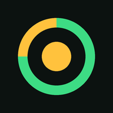
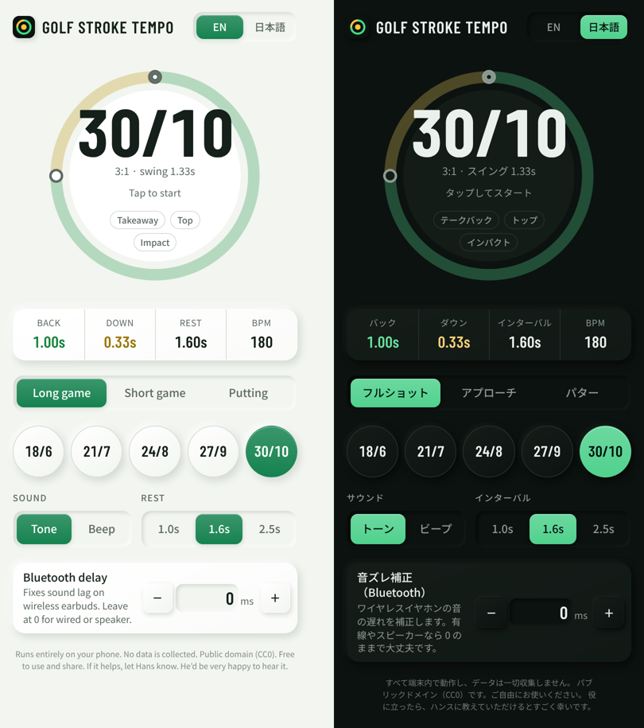
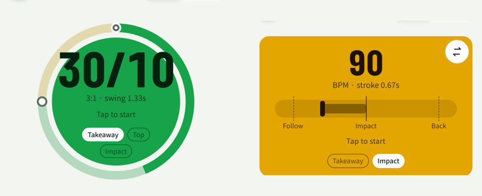
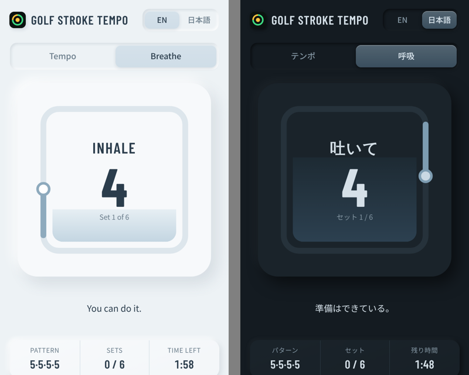

<p align="center">
  
</p>

<h1 align="center">Golf Stroke Tempo</h1>

<p align="center">
  ゴルフのスイングとパッティングのためのテンポ練習アプリです。心を整えるボックス呼吸のタブも付いています。<br>
  フレーム単位で正確な音とライト。ブラウザで動き、ホーム画面に追加すればオフラインでも使えます。<br>
  登録不要・広告なし・トラッキングなし。
</p>

<p align="center">
  <a href="README.md">English</a> · <b>日本語</b>
</p>

<p align="center">
  
</p>

---

## アプリを開く

**`https://<ユーザー名>.github.io/golf-stroke-tempo/`**

*（公開後、`<ユーザー名>` をご自身の GitHub ユーザー名に置き換えてください。手順は [docs/DEPLOY.md](docs/DEPLOY.md) にあります）*

スマホでリンクを開き、ダイヤルをタップして、音に合わせてスイングします。

## 主な機能

- **3つのモード**
  - **フルショット**：3:1 のテンポ。プリセット 18/6・21/7・24/8・27/9・30/10
  - **アプローチ**：2:1 のテンポ。プリセット 14/7・16/8・18/9・20/10・22/11
  - **パター**：80 または 90 BPM。テークバックとインパクトの2音
- **フレーム単位の正確なタイミング**：プリセットは 30fps の動画フレーム数です。`24/8` は、バック 24 フレーム（0.80 秒）、ダウン 8 フレーム（0.27 秒）です。
- **ズレない**：すべての音をスマホのオーディオクロック上で先に予約して鳴らすため、何百回繰り返してもリズムが狂いません。
- **ライトは音と完全に連動**：色が変わるのは必ず音が鳴った瞬間だけです。目と耳の情報が常に一致します。
- **パターの振り子表示**：パターモードでは、ダイヤル右上のボタンで「円」「バー（右にテークバック）」「レフティ用バー（左にテークバック）」を切り替えられます。
- **2種類の音**：やわらかい「トーン」と、はっきりした「ビープ」。
- **インターバル**：1回ごとの間隔を 1.0・1.6・2.5 秒から選べます。
- **音ズレ補正（Bluetooth）**：ワイヤレスイヤホンは音が遅れて聞こえます。0〜500ms（10ms 単位、数値の直接入力も可）で、ライトの変化と音が合うまで調整してください。有線イヤホンや本体スピーカーなら 0 のままで大丈夫です。
- **呼吸タブ（ボックス呼吸）**：やさしい水色のタブ。5·5·5·5 で鼻から吸って鼻から吐く呼吸を、呼吸音・ゴング（開始時・1分ごと・最後のセットの後）・励ましの言葉でリードします。長さはセット数か分で設定できます。詳しくは[ボックス呼吸](#ボックス呼吸)へ。
- **集中モード**：スマホを横向きにすると、タイマーだけが画面いっぱいに表示されます。設定を変えるときは縦向きに戻してください。
- **英語・日本語対応**、ライト・ダークモード（スマホの設定に連動）。再生中は画面がスリープしません。
- **プライバシー**：すべて端末内で動作し、設定もスマホ内にだけ保存されます。

<p align="center">
  
</p>
<p align="center"><sub>左：フルショットのバックスイング中。右：パターのバー表示（インパクト）。</sub></p>

## タイミングの仕組み

### フルショット・アプローチ

プリセットは 30fps でのフレーム数 `X/Y` です（1 フレーム = 33.3 ms）。

| 合図 | タイミング | 音（トーン） | ライト |
|---|---|---|---|
| 準備 | テークバックの直前 | | 薄い緑 |
| テークバック | `t = 0` | D5（587 Hz） | 緑。リングが緑で進む |
| トップ | `t = X ÷ 30 秒` | D5（587 Hz） | 黄。リングが黄色で進む |
| インパクト | `t = (X + Y) ÷ 30 秒` | A5（880 Hz）、少し長め | 黄色に光る |

その後、設定したインターバルを置いて次の1回が始まります。「ビープ」では、テークバックとトップが 1kHz、インパクトが 2kHz です。

### パター

設定したテンポの1拍で動きます。1回目の音でストローク開始、1拍後の2回目の音がインパクトです。90 BPM ならテークバックからインパクトまで 0.67 秒、80 BPM なら 0.75 秒です。

ライトはテークバックの音で緑になり、インパクトの音で黄色に変わります。バー表示では、ヘッドが1拍の 3 分の 2 でバックし、2回目の音とぴったり同時にインパクトラインを通過して、バックと同じ距離だけフォローへ抜けます。

## ボックス呼吸

ラウンド前やショットの合間に、気持ちを落ち着けるためのタブです。パターンは **5·5·5·5**、**鼻から吸って、鼻から吐きます**。

| ボックスの辺 | 呼吸 | 音 | ボックスの中 |
|---|---|---|---|
| 左の辺を上へ | 鼻から**吸って**、5秒 | やわらかい鼻の吸気音 | 光の高さに合わせて下から満ちていく |
| 上の辺 | **キープ**、5秒 | 無音 | 満ちたまま |
| 右の辺を下へ | 鼻から**吐いて**、5秒 | やわらかい鼻の呼気音 | 光の高さに合わせて空になっていく |
| 下の辺 | **キープ**、5秒 | 無音 | 空のまま |

ボックスを1周すると **1セット**（20秒）です。

- **長さ**：「セット」（標準は7セット）か「分」を選び、数字を入力するか − / + で調整します。分は必ず整数のセット数に換算され（1分 = 3セット）、**セッションは必ず最後のセットを下の辺のキープまで終えてから終了**します。途中で長さを変えても、今のセットは最後まで続きます。
- **ゴング**：開始時・1分ごと・最後のセットの後に鳴ります。最初の吸気は開始のゴングの1.5秒後に始まり、1分ごとのゴングも同じ間合いです。前のゴングからちょうど1分後、その分の最初の吸気の1.5秒前に鳴るので、呼吸の音と重なることはありません。
- **励ましの言葉**：セットごとに「いつもの練習どおりに。」「あなたならできる。」「ゆっくりは滑らか。滑らかは速い。」のような短い言葉が、ランダムな順番（同じ言葉が続かない）でふわっと表示されます。
- **なめらかな動き**：光は呼吸のように、角ではゆっくり、辺の中ほどでは少し速く進みます。止まることはなく、角には必ず5秒ちょうどで届きます。光の後ろには途切れない軌跡が残り、ゆっくりと均一に薄れていきます。光のすぐ後ろがいちばん明るく、光が一周して戻るころには完全に消えているので、途中でぷつりと切れることはありません。最後のセットのあとは、締めのゴングとともに軌跡が消えていきます。
- **やわらかな見た目**：ボックスの中に硬いふちはありません。光はほのかに輝くやわらかな玉、軌跡はやさしく光り始まりも丸く、トラックと内側のパネルのふちもぼかしています。満ちていく水面も、くっきりした線ではなく、やわらかなグラデーションです。
- **落ち着いた色**：彩度をおさえた、やわらかなブルーグレー。昼は明るく、夜は暗めです。色と感情の研究では、彩度が高いほど気持ちが高ぶりやすく、青はもっとも落ち着く色相とされているため、鮮やかな色は使っていません。
- **サウンド**：オン（ゴングと呼吸音）／オフ（光のみ）。セッション中でも切り替えられます。
- **画面を消しても続く**：セッション全体を1本の音声トラックとして（約0.1秒で）作り、メディアとして再生するため、スマホをロックしたり他のアプリに切り替えたりしても続きます。Android はブラウザでもホーム画面のアプリでも、iPhone は **Safari** で動作します。iPhone のホーム画面アプリは iOS がバックグラウンドで止めてしまうため、画面を消して使うときは Safari で開いてください。ロック画面に再生・一時停止が表示され、消音スイッチがオンでも音が鳴り、画面に戻ると光もすぐに追いつきます。ブラウザやビューアがメディアとしての再生を許可しない場合は、同じトラックを Web Audio で再生します（音とタイミングは同じで、画面オフ時の再生だけができません）。
- **音ズレ補正（Bluetooth）**：テンポタブで設定した値をそのまま使います。
- **やり方**：操作パネルの下に、日本語と英語で手順を表示しています。
- スマホを横向きにすると、ボックスと励ましの言葉だけが表示されます。

呼吸音は実際の鼻呼吸をもとにしています。音の高さが動かない自然な空気の流れの音で、口呼吸よりも高音がやわらかく、吸う音は軽く、吐く音はあたたかくし、終わりはなめらかに消えます。ゴングは揺れのない澄んだ余韻で、均一に消えていきます。すべての音はセッショントラック上の正確な位置に置かれ、光とカウントダウンはトラック自身の時計に合わせて動くため、常に同時に切り替わります。呼吸を始めるとゴルフのタイマーは止まり、テンポタブに戻ると呼吸は止まります。

<p align="center">
  
</p>

## アプリとしてインストール

サイトを公開したあと：

- **iPhone**：**Safari** でリンクを開く → 共有 → **ホーム画面に追加**
- **Android**：**Chrome** でリンクを開く → ⋮ → **アプリをインストール**（または **ホーム画面に追加**）

専用アイコンから全画面で起動し、一度開いたあとはインターネットなしでも使えます。

> **iPhone**：消音スイッチ（マナーモード）をオフにしないと、音が鳴らない場合があります。

## 自分で公開する

1. `golf-stroke-tempo` という名前で **公開（Public）** リポジトリを作ります。
2. このフォルダの中身をすべてアップロードします（`icons/` と `docs/` フォルダもそのまま）。
3. **Settings → Pages** → Source を **Deploy from a branch** → ブランチ `main`、フォルダ `/ (root)` → **Save**。
4. 1分ほどで `https://<ユーザー名>.github.io/golf-stroke-tempo/` に公開されます。

更新方法やトラブル対処を含む詳しい手順：**[docs/DEPLOY.md](docs/DEPLOY.md)**

## ファイル構成

```
golf-stroke-tempo/
├── index.html             アプリ本体（HTML・CSS・JavaScript を1ファイルに）
├── manifest.webmanifest   ホーム画面に追加するときの名前・アイコン・色
├── sw.js                  オフライン用にアプリを保存するサービスワーカー
├── icons/                 アプリアイコン（192、512、マスカブル 512、Apple 180）
├── docs/
│   ├── DEPLOY.md          GitHub Pages の公開・更新ガイド（英語・日本語）
│   ├── screenshot.png
│   └── states.png
├── .nojekyll              GitHub Pages でファイルをそのまま配信するための設定
├── README.md
├── README.ja.md
└── LICENSE                CC0 1.0（パブリックドメイン）
```

ビルド作業・フレームワーク・外部ライブラリは不要です。パスはすべて相対パスなので、GitHub Pages のプロジェクト URL でも独自ドメインでも、そのまま動きます。

## ローカルで動かす

`index.html` を直接開いても確認できますが、オフライン機能とインストールは `https://` か `localhost` でのみ動作します：

```bash
cd golf-stroke-tempo
python3 -m http.server 8000
# ブラウザで http://localhost:8000 を開く
```

## 更新するとき

編集してコミット・プッシュするだけです。インターネットにつながっていれば常に最新のページを読み込むので、次にアプリを開いたときに反映されます（古い版が入っているスマホでは、2回開いてください）。

**アイコン**を変更した場合は、`sw.js` の `VERSION` も上げてください：

```js
const VERSION = 'golf-stroke-tempo-v3';   // 以前は v2
```

## 対応ブラウザ

最新の Safari（iOS 15 以降）、Chrome、Edge、Firefox。タイミングには Web Audio API、画面のスリープ防止には Screen Wake Lock API（対応端末のみ）、オフライン動作にはサービスワーカーを使っています。

**ダークモード**：スマホのライト／ダーク設定に合わせて表示が切り替わります。ブラウザによっては、ページを独自に暗く変換するものがあり（Samsung Internet のダークモードや一部のアプリ内ブラウザなど）、白い背景に白い文字が出てしまうことがあります。このアプリでは、文字の背景になる部分をすべて通常のページ要素として描いているため、ブラウザが文字と背景をいっしょに変換し、文字が読めなくなることはありません。また、変換を検知できるブラウザ（Chrome や Android のアプリ内ブラウザ）では、アプリ専用のダークテーマに自動で切り替わります。Samsung Internet では「Labs」の「Use website dark theme」をオンにすることもできます。

## プライバシー

- アカウント登録、アクセス解析、広告、Cookie はありません。
- 設定（言語・モード・プリセット・音・インターバル・音ズレ補正・パター表示・呼吸の設定・最後に開いたタブ）は、端末のブラウザ内にのみ保存されます。
- 外部への通信は、書体を読み込むための Google Fonts だけです。一度読み込めばオフライン用に保存され、読み込めない場合はシステムフォントで表示されます。

## ライセンス

**パブリックドメイン（CC0 1.0）**です。用途を問わず、許可なく自由に使用・複製・改変・共有できます。詳しくは [LICENSE](LICENSE) をご覧ください。

役に立ったら、ハンスに教えていただけるとすごく幸いです。
